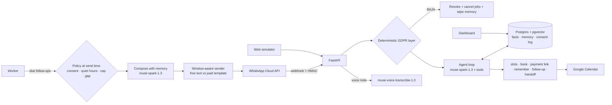

# Senda — a WhatsApp agent that follows up for 30 days, GDPR by design

**Meta Global AI Developer Hackathon 2026 · Indie track · Built with Meta Model API (Muse Spark 1.3 + Muse Voice Transcribe)**

Small clinics in Spain run their whole front desk on WhatsApp. They lose bookings for two boring reasons: nobody answers at 22:00, and nobody follows up three days later. Chatbots fix the first one. They can't do the second, because following up needs **memory that lasts weeks**, **timing that feels human**, **consent you can prove**, and **cost discipline**, since every business-initiated WhatsApp message outside the 24-hour window is a paid template.

Senda is the agent that does the second job. It runs inside the clinic's WhatsApp for 30 days per lead:

- **Understands what customers actually send.** It handles text, noisy voice notes (Muse Voice Transcribe) and photos (Muse Spark vision), in peninsular Spanish.
- **Books real appointments** against the clinic's opening hours and Google Calendar, and collects the deposit link.
- **Remembers.** It keeps structured facts (name, payday, objection) plus semantic recall over the whole conversation (pgvector). "I get paid on the 15th" becomes a follow-up on the next allowed business day after the 15th.
- **Follows up like a person.** It runs declarative sequences with quiet hours (09–21 Europe/Madrid, no Sundays), a per-contact cap and a minimum gap between messages. Any reply from the customer cancels pending sales follow-ups automatically.
- **Knows what each message costs.** It sends free-form messages inside the 24-hour customer-service window, switches to approved templates outside it, prices each send by category (marketing / utility), and reports the money saved against a fixed-cadence bot.
- **Is GDPR-compliant by construction**, not by prompt. See below.

## Why this was not buildable a year ago

| Hard part | How Senda solves it |
|---|---|
| Long-running state (30 days, many sessions) | Postgres is the agent's state: facts table, pgvector memory, durable follow-up queue (`FOR UPDATE SKIP LOCKED`), and an audit log of every tool call |
| Multimodal input from real users | WhatsApp OGG/Opus → ffmpeg → WAV 16 kHz → `muse-voice-transcribe-1.0`; images go to `muse-spark-1.3` as `image_url` parts |
| Reliable tool use | 9 tools with server-side validation (the API's `strict` defaults to false). Booking re-checks availability, and the agent cannot touch consent |
| Legal correctness | A deterministic consent layer runs **before** the LLM: SÍ / NO / BAJA / ALTA, with literal evidence stored (Art. 7.1). BAJA cancels every job and wipes the follow-up memory. Health data is refused by the memory layer (Art. 9). Includes access/export (Art. 15/20), erasure (Art. 17) and a 30-day retention purge |
| Unit economics | Window-aware sending + per-category pricing + "messages avoided" accounting |

## Architecture



## Run it

```bash
cp .env.example .env          # set MODEL_API_KEY
docker compose up --build -d
open http://localhost:8000/simulador   # WhatsApp simulator (no phone number needed)
open http://localhost:8000/dashboard   # business dashboard
```

Use the **time machine** buttons in the simulator (+24 h / +72 h) to watch follow-ups fire, get cancelled when the customer replies, or switch to paid templates once the 24-hour window closes.

### Connecting a real WhatsApp number (optional)

1. In your Meta app, set the webhook to `https://<your-host>/webhook` with verify token `WA_VERIFY_TOKEN`, and subscribe to `messages`.
2. Fill in `WA_ACCESS_TOKEN`, `WA_PHONE_NUMBER_ID`, `WA_APP_SECRET` and `GRAPH_API_VERSION`.
3. Create two templates (language `es`), each with body variables `{{1}}` = first name and `{{2}}` = personalised line:
   - `senda_seguimiento` (Marketing): `Hola {{1}}, {{2}}`
   - `senda_recordatorio_cita` (Utility): `Hola {{1}}, {{2}}`

### Google Calendar (optional)

Create a service account, share the clinic calendar with it ("make changes to events"), put the JSON in `./secrets/` and set `GOOGLE_SERVICE_ACCOUNT_FILE=/app/secrets/<file>.json` and `GOOGLE_CALENDAR_ID`. Without these, Senda uses its own Postgres agenda.

## Tests

```bash
make test   # runs against a separate senda_test database
```

The suite has 30 tests: the consent grammar, the full conversion flow, BAJA, the payday follow-up, handoff, quiet hours, the 24-hour window and pricing, audio transcription, the webhook signature, dedupe and the GDPR rights endpoints. Tests use a rule-based stand-in for the LLM (`LLM_PROVIDER=fake`) so they're deterministic. The product itself runs on Muse Spark.

## Honest notes

- **Payments.** Bizum has no public API for payment links; merchants reach it through their bank's virtual POS (e.g. Redsys). The demo uses a simulated gateway page that triggers the same confirmation flow. Swapping in the real gateway only touches `senda/payments.py`.
- **Embeddings.** Meta Model API has no embeddings endpoint, so memory uses a local multilingual model (`paraphrase-multilingual-MiniLM-L12-v2` via fastembed, CPU).
- **Prices.** WhatsApp prices per message are configurable in `.env`. Check them against Meta's current rate card for Spain.
- The privacy notice is a template; a clinic's DPO must review it.

## Repo map

```
senda/agent.py            inbound pipeline + agent loop + follow-up composer
senda/gdpr.py             deterministic consent layer, export, erasure
senda/memory.py           facts + pgvector recall + retention purge
senda/scheduler.py        follow-up sequences and send-time policy
senda/channels/outbound.py  24 h window + template + cost accounting
senda/tools.py            tool schemas + validated dispatch
senda/llm.py              Meta Model API client (chat + ASR)
senda/web/                FastAPI, simulator, dashboard, payment page
config/business.json      clinic profile: services, prices, hours, escalation rules
db/init.sql               schema
```

Built by Gelo Saldaña — Saldaña Digital.
